# Exception Handling Class Diagram

## Overview

The following class diagram represents the exception-handling and
validation architecture introduced in GameZone Unicesar.

It includes the custom exception hierarchy, the three validators,
the services that invoke them, the repositories responsible for
persistence, and the console user interface.

The existing application uses `GameZoneUI` as its console interface.
It therefore represents the role described as `ConsoleMenu` in the
Requerimiento 6 specification.

```mermaid
classDiagram
    direction TB

    %% =========================================
    %% CUSTOM EXCEPTION HIERARCHY
    %% =========================================

    class GameZoneException {
        <<exception>>
        -String errorCode
        +GameZoneException(String message)
        +GameZoneException(String message, String errorCode)
        +getErrorCode() String
    }

    class ResourceNotFoundException {
        <<exception>>
        +ResourceNotFoundException(String resourceType, String identifier)
    }

    class BusinessRuleException {
        <<exception>>
        +BusinessRuleException(String message)
    }

    class InvalidDataException {
        <<exception>>
        +InvalidDataException(String fieldName, String description)
    }

    class PersistenceException {
        <<exception>>
        +PersistenceException(String message, Throwable cause)
    }

    GameZoneException <|-- ResourceNotFoundException
    GameZoneException <|-- BusinessRuleException
    GameZoneException <|-- InvalidDataException
    GameZoneException <|-- PersistenceException

    %% =========================================
    %% VALIDATION LAYER
    %% =========================================

    class ProductValidator {
        <<utility>>
        +validateProductData(String id, String title, double price, int stock) void$
        +validateStockAvailability(Product product, int requestedQuantity) void$
        +validateProductExists(Product product, String productId) void$
    }

    class PersonValidator {
        <<utility>>
        +validatePersonData(String id, String name, String email, String phone) void$
        +validatePersonExists(Person person, String personId) void$
        +validateUniquePerson(List~Person~ existing, String newId) void$
    }

    class SaleValidator {
        <<utility>>
        +validateSaleData(Customer customer, Seller seller, List~Product~ products) void$
        +validateSaleExists(Sale sale, String saleId) void$
    }

    %% =========================================
    %% SERVICE LAYER
    %% =========================================

    class ProductService {
        +registerVideoGame(VideoGame videoGame) void
        +registerConsole(Console console) void
        +listProducts() List~Product~
        +updateStock(String productIdentifier, int quantity) void
        +restoreStock(String productId, int quantity) void
    }

    class PersonService {
        +registerCustomer(Customer customer) void
        +listCustomers() List~Customer~
        +listSellers() List~Seller~
    }

    class SaleService {
        +registerSale(Sale sale, List~String~ productIdsWithExtendedWarranty) void
        +listSales() List~Sale~
    }

    %% =========================================
    %% PERSISTENCE LAYER
    %% =========================================

    class ProductRepository {
        +save(Product product) void
        +findAll() List~Product~
        +findByIdentifier(String identifier) Product
        +saveProducts(List~Product~ products) void
    }

    class PersonRepository {
        +saveCustomers(List~Customer~ customers) void
        +loadCustomers() List~Customer~
        +saveSellers(List~Seller~ sellers) void
        +loadSellers() List~Seller~
    }

    class SaleRepository {
        +saveSales(List~Sale~ sales) void
        +loadSales() List~Sale~
    }

    %% =========================================
    %% USER INTERFACE
    %% =========================================

    class GameZoneUI {
        +showMainMenu() void
        +showProductMenu() void
        +showPersonMenu() void
        +showSaleMenu() void
    }

    %% =========================================
    %% DOMAIN MODEL REFERENCES
    %% =========================================

    class Product {
        <<abstract>>
    }

    class Person {
        <<abstract>>
    }

    class Customer
    class Seller
    class VideoGame
    class Console
    class Sale

    Person <|-- Customer
    Person <|-- Seller
    Product <|-- VideoGame
    Product <|-- Console

    %% =========================================
    %% SERVICE TO VALIDATOR DEPENDENCIES
    %% =========================================

    ProductService ..> ProductValidator : validates product data and stock
    PersonService ..> PersonValidator : validates people and uniqueness
    SaleService ..> SaleValidator : validates sales
    SaleService ..> ProductValidator : validates product existence and stock

    %% =========================================
    %% VALIDATOR TO MODEL DEPENDENCIES
    %% =========================================

    ProductValidator ..> Product : checks product data
    PersonValidator ..> Person : checks person data
    SaleValidator ..> Customer : validates customer
    SaleValidator ..> Seller : validates seller
    SaleValidator ..> Product : validates sale items
    SaleValidator ..> Sale : checks sale existence

    %% =========================================
    %% SERVICE TO PERSISTENCE DEPENDENCIES
    %% =========================================

    ProductService ..> ProductRepository : persists products
    PersonService ..> PersonRepository : persists people
    SaleService ..> SaleRepository : persists sales

    %% =========================================
    %% EXCEPTION GENERATION
    %% =========================================

    ProductValidator ..> InvalidDataException : invalid product data
    ProductValidator ..> BusinessRuleException : insufficient stock
    ProductValidator ..> ResourceNotFoundException : missing product

    PersonValidator ..> InvalidDataException : invalid person data
    PersonValidator ..> BusinessRuleException : duplicate identifier
    PersonValidator ..> ResourceNotFoundException : missing person

    SaleValidator ..> InvalidDataException : invalid sale references
    SaleValidator ..> BusinessRuleException : sale without products
    SaleValidator ..> ResourceNotFoundException : missing sale

    ProductService ..> GameZoneException : reports application errors
    PersonService ..> GameZoneException : reports application errors
    SaleService ..> GameZoneException : reports application errors

    ProductRepository ..> PersistenceException : wraps IO failures
    PersonRepository ..> PersistenceException : wraps IO failures
    SaleRepository ..> PersistenceException : wraps IO failures

    %% =========================================
    %% UI INTEGRATION
    %% =========================================

    GameZoneUI ..> ProductService : invokes product operations
    GameZoneUI ..> PersonService : invokes people operations
    GameZoneUI ..> SaleService : invokes sales operations

    GameZoneUI ..> ResourceNotFoundException : catches missing resources
    GameZoneUI ..> BusinessRuleException : catches business violations
    GameZoneUI ..> InvalidDataException : catches invalid input
    GameZoneUI ..> PersistenceException : catches persistence failures
```



## Architectural Notes

### Exception Hierarchy

`GameZoneException` extends `RuntimeException` and provides the
common error code.

The four specialized exceptions inherit from this class, allowing the
application to distinguish different categories of failures.

### Validation Layer

The service layer invokes the appropriate validator before continuing
with an operation.

Validators contain validation rules and operate on objects and data
passed to them. They do not access repositories or perform file
operations.

### Persistence Layer

`ProductRepository`, `PersonRepository`, and `SaleRepository`
are responsible for persistence.

When the corresponding repositories encounter an `IOException`,
they should throw `PersistenceException` with contextual information
and preserve the original cause.

### User Interface

`GameZoneUI` handles the specialized exceptions separately and
displays Spanish messages appropriate to each category.

Technical details and raw stack traces should not be shown to users.

### Dependency Direction

The intended dependency direction remains:

```text
UI -> Service -> Validation / Persistence -> Model
```

The exception hierarchy is transversal and can be used by the
appropriate layers.

The validation layer must not depend on the persistence layer.