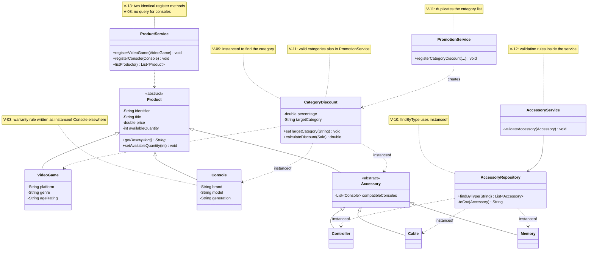
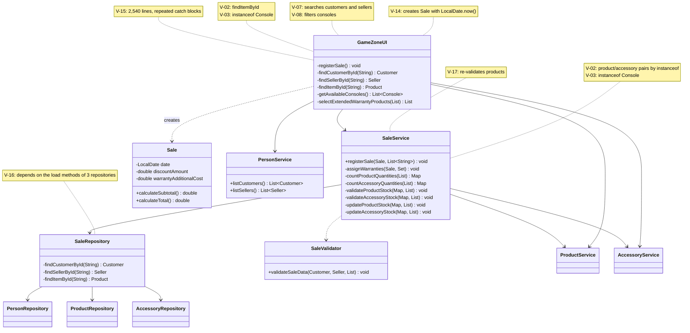
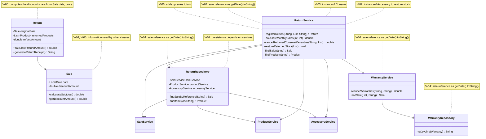

# GRASP Class Diagram - Before and After

Classes involved in the violations of the consolidated audit
(`docs/grasp-audit/consolidated-audit.md`). The notes show the violation
ids (V-XX) related to each class. Only the attributes, methods and
relations relevant to the violations are shown.

## Before (start of Phase 2)

State of `develop` at the start of Phase 2, before the first correction.

### 1. Products, accessories and promotions

### 2. Sales and user interface

### 3. Returns and warranties

## After (end of Phase 2)

Recorded by the Technical Lead at the end of Phase 2.
